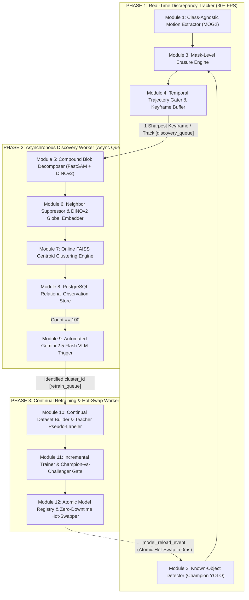
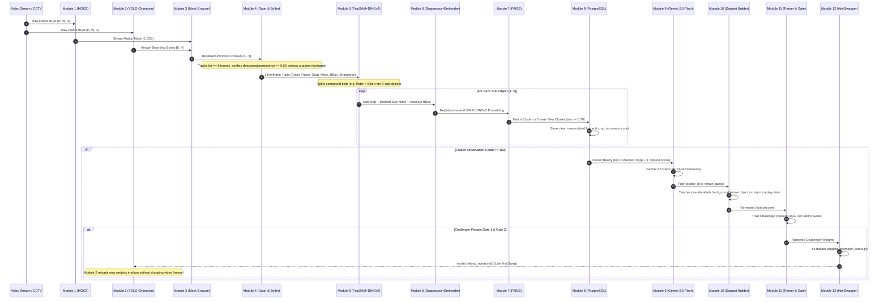

# 12-Module Open-World Continual Discovery & Retraining Pipeline
## Complete Technical Documentation Hub

> **System Overview:** An autonomous surveillance AI engine that overcomes the closed-world assumption of traditional object detectors. It continuously discovers, isolates, clusters, visually names, incrementally retrains, and hot-swaps new moving physical objects in real-time CCTV streams without human supervision and without catastrophic forgetting.

---

## 1. System Architecture at a Glance

The pipeline operates across **three multiprocessing tiers**, decoupling high-speed frame processing (30+ FPS) from heavy machine learning inference and continual model training.

---

## 2. Master Module Index

Click on any module to view its dedicated, in-depth documentation including all submodules, mathematical formulations, class references, schemas, and source code links.

| # | Module Name | Phase | Primary Function | Key Submodules | Dedicated Documentation |
|---|---|---|---|---|---|
| **01** | **Class-Agnostic Motion Extraction** | Phase 1 | Pixel-level moving object segmentation; eliminates shadows and stationary background. | MOG2 background subtractor, shadow thresholding, morphological filter. | [Module 01 Guide](file:///Users/mayur/Documents/NEW_FYP/docs/module_01_motion_extraction.md) |
| **02** | **Known-Object Detection** | Phase 1 | Standard closed-world detection using active Champion weights; supports holdout classes. | YOLOv11 engine, holdout class filter, dynamic in-memory weight reloader. | [Module 02 Guide](file:///Users/mayur/Documents/NEW_FYP/docs/module_02_known_detection.md) |
| **03** | **Mask-Level Known Erasure** | Phase 1 | Subtraction of known objects from motion mask with safety padding to leave unknown residuals. | 15px box dilation, bitwise mask zeroing, minimum area contour filter. | [Module 03 Guide](file:///Users/mayur/Documents/NEW_FYP/docs/module_03_mask_erasure.md) |
| **04** | **Temporal Trajectory Gating** | Phase 1 | Tracks unknown blobs over time; rejects stationary oscillations (foliage); picks best keyframe. | ByteTracker, Kalman filter, directional persistence gater, sharpness buffer. | [Module 04 Guide](file:///Users/mayur/Documents/NEW_FYP/docs/module_04_temporal_gating.md) |
| **05** | **Compound Blob Decomposition** | Phase 2 | Splits merged unknown objects (e.g., rider + bike) into clean individual sub-objects. | FastSAM part proposer, DINOv2 mask pooling, cosine merging, MaskCut fallback. | [Module 05 Guide](file:///Users/mayur/Documents/NEW_FYP/docs/module_05_compound_decomposition.md) |
| **06** | **Neighbor Suppression & Embeddings** | Phase 2 | Masks touching neighbors to neutral gray (128) and extracts 384-D invariant DINOv2 vector. | Neutral gray background/neighbor masking, letterbox pad, DINOv2-Reg embedder. | [Module 06 Guide](file:///Users/mayur/Documents/NEW_FYP/docs/module_06_feature_extraction.md) |
| **07** | **Online FAISS Clustering** | Phase 2 | Cosine similarity indexing and dynamic running centroid maintenance in open-world space. | `IndexFlatIP`, running centroid update formula, disk persistence & sync. | [Module 07 Guide](file:///Users/mayur/Documents/NEW_FYP/docs/module_07_faiss_clustering.md) |
| **08** | **Database & Observation Store** | Phase 2 | Persistent relational storage for clusters, observations, clean frames, and model lineage. | PostgreSQL schema, SQLite fallback, clean frame preservation, strict env isolator. | [Module 08 Guide](file:///Users/mayur/Documents/NEW_FYP/docs/module_08_database_store.md) |
| **09** | **Automated VLM Discovery** | Phase 2 | Queries Gemini 2.5 Flash on 100-sample clusters to autonomously validate and name novel classes. | 100-obs gater, in-memory red-box prompt builder, Pydantic JSON parser, queue pusher. | [Module 09 Guide](file:///Users/mayur/Documents/NEW_FYP/docs/module_09_vlm_discovery.md) |
| **10** | **Continual Dataset Builder** | Phase 3 | Builds incremental YOLO dataset with Teacher pseudo-labeling and experience replay. | Sequential class mapper, 80/20 train/val splitter, Teacher pseudo-labeler, replay buffer. | [Module 10 Guide](file:///Users/mayur/Documents/NEW_FYP/docs/module_10_dataset_builder.md) |
| **11** | **Incremental Trainer & Metric Gate** | Phase 3 | Fine-tunes Challenger model and verifies old-class retention and new-class competence. | Backbone freezing (`freeze=10`), Gate 1 (old mAP regression), Gate 2 (new mAP/recall). | [Module 11 Guide](file:///Users/mayur/Documents/NEW_FYP/docs/module_11_continual_trainer.md) |
| **12** | **Atomic Model Registry & Hot-Swap** | Phase 3 | Promotes validated weights atomically via `os.replace` and triggers live in-place reloading. | Model registry audit logger, atomic POSIX/NTFS file replacer, IPC signal emitter. | [Module 12 Guide](file:///Users/mayur/Documents/NEW_FYP/docs/module_12_atomic_hot_swap.md) |
| **13** | **Pipeline Orchestration** | All | Multi-process supervisor managing worker lifecycles, queues, signals, and graceful shutdown. | Process workers, queue backpressure, atomic event loop, teardown handlers. | [Orchestration Guide](file:///Users/mayur/Documents/NEW_FYP/docs/pipeline_orchestration.md) |

---

## 3. End-to-End Object Lifecycle

---

## 4. Key Architectural Guarantees & Constraints

1. **Zero Contamination of Training Data:**
   - Visual annotations (such as red bounding boxes) are **NEVER** drawn on disk files.
   - Bounding boxes are drawn **only on in-memory clones** when querying Gemini 2.5 Flash.
   - Module 10 reads pristine, clean full frames from disk so the newly trained YOLO model never learns red bounding boxes as physical features.
2. **Prevention of Unlabeled Foreground Suppression:**
   - In incremental datasets, existing known objects visible in the scene are automatically labeled by the **Champion Teacher Model** at `conf=0.50`. This prevents YOLO from penalizing known objects as background.
3. **Prevention of Catastrophic Forgetting:**
   - Dual-safeguard: Experience Replay Buffer (historical exemplars) + Backbone layer freezing (`freeze=10`) + Gate 1 metric enforcement ($\Delta\text{mAP} \ge -0.015$).
4. **Strict Decoupling of Phase 1 Credential Isolation:**
   - PostgreSQL and Gemini credentials are read strictly from `../FYP_phase1/.env`. No business logic or Python files are imported from outside the repository.
5. **Zero-Downtime Hot-Swapping:**
   - Upstream 30+ FPS surveillance tracking is never paused or restarted when new weights are trained. Promotion is atomic, and the YOLO detector reloads weights on the fly.
