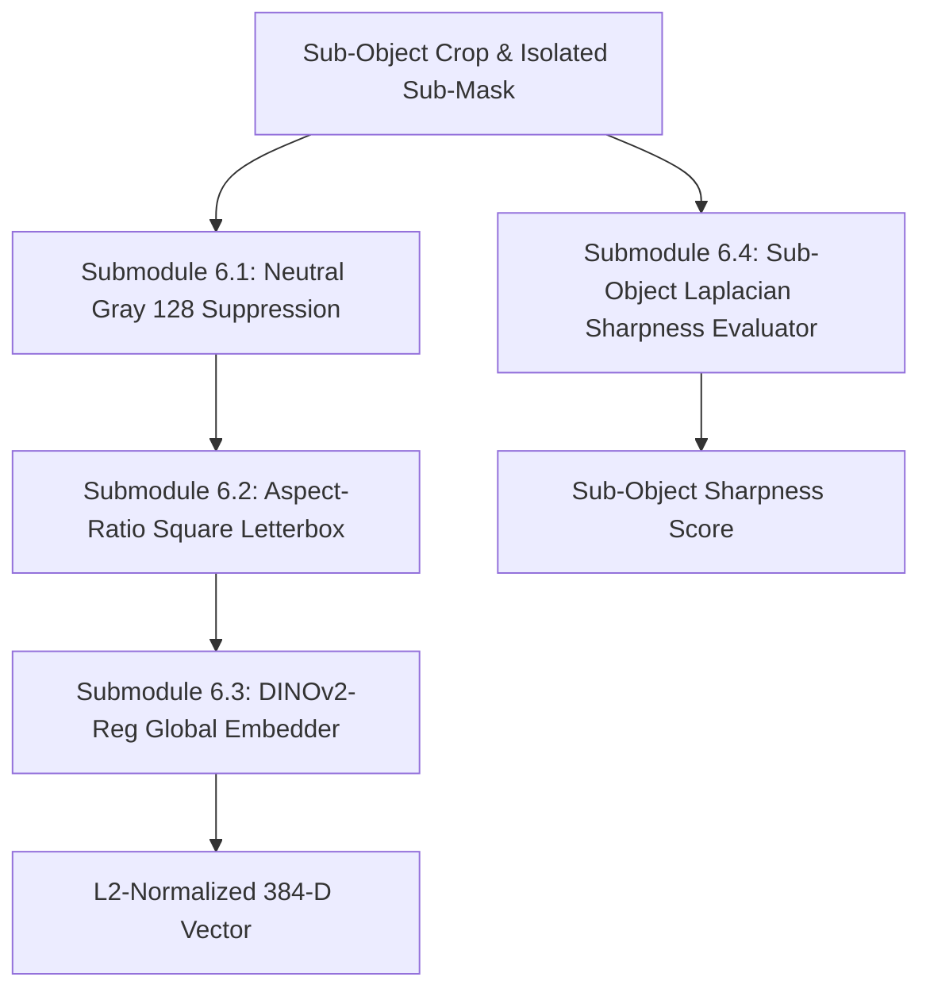

# Module 6: Neighbor & Background Suppression + DINOv2 Feature Extraction

## 1. Executive Summary & Purpose

Module 6 takes each isolated sub-object produced by **Module 5** and prepares it for open-world semantic clustering in **Module 7**.

### The Critical Challenge
Even when two touching objects (such as a Rider and a Bicycle) are decomposed into two bounding boxes, their rectangular crops still physically overlap:
- The bicycle's crop will contain parts of the rider's legs in the background.
- The rider's crop will contain parts of the bicycle handlebars and frame.

If an off-the-shelf vision transformer directly embeds these raw crops, the visual representation is **polluted by touching neighbor pixels and static background clutter**.

Module 6 resolves this by applying **strict pixel-level neighbor and background suppression to neutral gray `(128, 128, 128)`**, applying square letterbox padding, and extracting an L2-normalized 384-dimensional **DINOv2 with Registers (`dinov2_vits14_reg`)** feature embedding.

---

## 2. Submodule Breakdown

Module 6 is implemented in [module_6/](file:///Users/mayur/Documents/NEW_FYP/module_6/):



### Submodule 6.1: Touching Neighbor & Background Suppression
- **Source File:** [dinov2_extractor.py](file:///Users/mayur/Documents/NEW_FYP/module_6/dinov2_extractor.py#L45-L70)
- **Neutral Gray Masking:**
  Using the isolated sub-object binary mask $\mathbf{M}_{\text{sub}} \in \{0, 255\}^{h \times w}$ from Module 5, all pixels outside the true physical silhouette are replaced with neutral gray:
  $$\mathbf{I}_{\text{suppressed}}(x, y) = \begin{cases} \mathbf{I}_{\text{raw}}(x, y) & \text{if } \mathbf{M}_{\text{sub}}(x, y) > 0 \\ [128, 128, 128]^T & \text{otherwise} \end{cases}$$
- **Why Neutral Gray (128, 128, 128) instead of Black (0, 0, 0):**
  1. ImageNet-pretrained vision models normalize inputs using mean $\boldsymbol{\mu} \approx [0.485, 0.456, 0.406]$ and std $\boldsymbol{\sigma} \approx [0.229, 0.224, 0.225]$. Value 128 ($0.5$ in $[0, 1]$) maps nearly to zero in normalized tensor space, minimizing artificial gradient signals.
  2. Pure black ($0$) creates high-contrast artificial edges that self-attention layers mistake for strong geometric object boundaries.

### Submodule 6.2: Aspect-Ratio Square Letterbox Padding
- **Source File:** [dinov2_extractor.py](file:///Users/mayur/Documents/NEW_FYP/module_6/dinov2_extractor.py#L71-L90)
- **Operation:**
  Given crop dimensions $(h, w)$:
  1. Computes dimension $D = \max(h, w)$.
  2. Allocates a square canvas $\mathbf{C} \in \{128\}^{D \times D \times 3}$.
  3. Centers the suppressed crop:
     $$y_{\text{off}} = \lfloor (D - h) / 2 \rfloor, \quad x_{\text{off}} = \lfloor (D - w) / 2 \rfloor$$
     $$\mathbf{C}[y_{\text{off}}:y_{\text{off}}+h, \; x_{\text{off}}:x_{\text{off}}+w] = \mathbf{I}_{\text{suppressed}}$$
  4. Resizes to $224 \times 224$ via bicubic interpolation without geometric distortion.

### Submodule 6.3: DINOv2-Reg Global Feature Extraction
- **Source File:** [dinov2_extractor.py](file:///Users/mayur/Documents/NEW_FYP/module_6/dinov2_extractor.py#L91-L125)
- **Model Choice:** `dinov2_vits14_reg` (Small Vision Transformer with 4 Register Tokens, patch size 14, 384 feature channels).
- **Why Registers are Critical:** Standard Vision Transformers (ViT) without register tokens produce high-norm artifact spikes in uniform background regions. DINOv2 with registers eliminates background artifact spikes, concentrating representation on the physical object.
- **Inference & L2-Normalization:**
  $$\mathbf{e} = \text{ViT}(\mathbf{C}_{224 \times 224}) \in \mathbb{R}^{1 \times 384}$$
  $$\mathbf{z} = \frac{\mathbf{e}}{\|\mathbf{e}\|_2} \implies \|\mathbf{z}\|_2 = 1.0$$
  Unit-norm vectors allow direct cosine similarity computation via inner product in FAISS.

### Submodule 6.4: Sub-Object Laplacian Sharpness Scoring
- **Source File:** [dinov2_extractor.py](file:///Users/mayur/Documents/NEW_FYP/module_6/dinov2_extractor.py#L126-L140)
- **Operation:** Evaluates sharpness specifically on the sub-object's raw crop:
  $$S_{\text{sub}} = \text{Var}\left(\nabla^2 I_{\text{sub\_gray}}\right)$$
  Stored in PostgreSQL to enable Module 9 and Module 10 to retrieve only the sharpest exemplars for VLM querying and dataset building.

---

## 3. Configuration & Parameter Reference

Configuration is managed via dataclass in [module_6/config.py](file:///Users/mayur/Documents/NEW_FYP/module_6/config.py):

| Parameter | Type | Default | Description |
|---|---|---|---|
| `model_name` | `str` | `"dinov2_vits14_reg"` | TorchHub model variant. |
| `input_size` | `Tuple[int, int]` | `(224, 224)` | Input resolution for transformer encoder. |
| `bg_fill_color` | `Tuple[int, int, int]` | `(128, 128, 128)` | RGB neutral fill for background and neighbors. |
| `device` | `str` | `"cuda"` / `"cpu"` | Compute device. |

---

## 4. Input / Output Data Specifications

### Input
- **`sub_raw`**: BGR crop of the sub-object.
- **`sub_mask`**: Binary mask of the sub-object.
- **`abs_bbox`**: Absolute coordinates $[x_1, y_1, x_2, y_2]$ in CCTV frame.
- **`frame_hw`**: Dimensions of the original frame $[H, W]$.
- **`method_label`**: Decomposition method provenance string.

### Output Dictionary
```python
{
    "bbox": [x1, y1, x2, y2],          # Tight absolute bounding box
    "frame_hw": [H, W],                 # Frame height and width
    "raw_crop": sub_raw,                # Clean unedited BGR crop
    "masked_crop": square_bgr,          # Square letterboxed crop with gray neutral background
    "embedding": emb,                   # L2-normalized numpy array of shape (1, 384), float32
    "sharpness": sharpness,             # Sub-object Laplacian variance score
    "method": method_label              # Provenance tag
}
```

---

## 5. Code Verification & Unit Testing

Module 6 is tested in `tests/test_module_6_embedding.py`:

```bash
pytest tests/test_module_6_embedding.py -v
```
