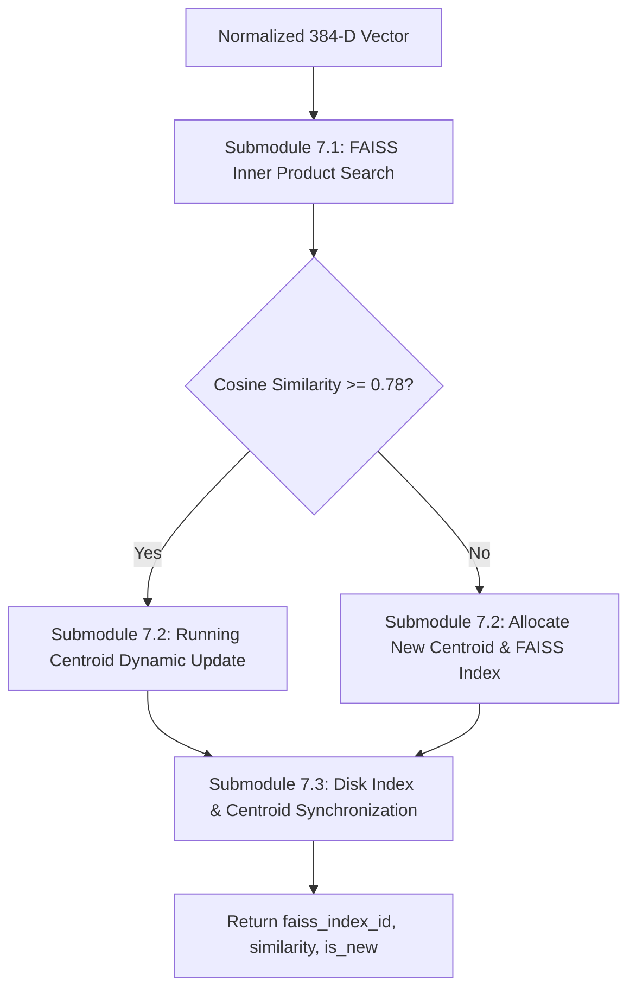

# Module 7: Online FAISS Centroid Clustering Engine

## 1. Executive Summary & Purpose

Module 7 implements the **online, self-supervised semantic memory** of the surveillance pipeline. Operating in **Phase 2**, its task is to ingest continuous 384-dimensional DINOv2 feature vectors from Module 6 and organize them into distinct, evolving clusters of physical object categories.

### Key Architectural Requirements
1. **Online Incremental Clustering:** The system cannot wait for batch offline clustering (such as $k$-means) because video streams are infinite and novel objects appear unpredictably.
2. **Centroid Plasticity:** As more observations of an object are captured across varying camera viewpoints, lighting, and scales, the cluster centroid must smoothly adapt to represent the true distribution center of that class.
3. **Crash Resilience & Inter-Process Synchronization:** The FAISS index and centroid vectors must be continuously synchronized to disk so restarts do not destroy discovered cluster memory.

---

## 2. Submodule Breakdown

Module 7 is implemented in [module_7/](file:///Users/mayur/Documents/NEW_FYP/module_7/):



### Submodule 7.1: FAISS Inner Product Search (`faiss.IndexFlatIP`)
- **Source File:** [faiss_clustering.py](file:///Users/mayur/Documents/NEW_FYP/module_7/faiss_clustering.py#L25-L65)
- **Mathematical Equivalence to Cosine Similarity:**
  Because all input vectors $\mathbf{x}$ are strictly L2-normalized ($\|\mathbf{x}\|_2 = 1.0$) and all centroids $\mathbf{c}_k$ are kept L2-normalized ($\|\mathbf{c}_k\|_2 = 1.0$), the inner product calculated by `IndexFlatIP` is mathematically identical to cosine similarity:
  $$\langle \mathbf{x}, \mathbf{c}_k \rangle = \sum_{d=1}^{384} x_d \cdot c_{k, d} = \|\mathbf{x}\|_2 \|\mathbf{c}_k\|_2 \cos(\theta) = \cos(\theta)$$
- **Nearest Neighbor Query:**
  ```python
  distances, indices = self.index.search(embedding.astype("float32"), k=1)
  best_sim = float(distances[0][0])
  best_id = int(indices[0][0])
  ```
- **Threshold Gating:**
  - If `best_sim >= FAISS_CLUSTER_THRESH` (default: $0.78$), the observation is merged into existing cluster `best_id`.
  - If `best_sim < 0.78` (or index is empty), a new cluster is allocated.

### Submodule 7.2: Online Dynamic Running Centroid Update Formula
- **Source File:** [faiss_clustering.py](file:///Users/mayur/Documents/NEW_FYP/module_7/faiss_clustering.py#L90-L135)
- **Running Mean Update:**
  When a new vector $\mathbf{x}$ joins cluster $k$ with current observation count $N_k$ and current centroid $\mathbf{c}_k$:
  $$\mathbf{c}_k^{(N+1)} = \frac{N_k \cdot \mathbf{c}_k^{(N)} + \mathbf{x}}{N_k + 1}$$
  $$\hat{\mathbf{c}}_k^{(N+1)} = \frac{\mathbf{c}_k^{(N+1)}}{\|\mathbf{c}_k^{(N+1)}\|_2}$$
- **Rebuilding FAISS Flat Index:**
  Because `IndexFlatIP` does not support in-place vector mutation of individual rows, Module 7 updates its in-memory centroid list `self.centroids[best_id]` and updates the index vector:
  ```python
  self.centroids[best_faiss_id] = updated_norm_c
  # Rebuild lightweight index (typically < 500 clusters, takes < 0.1 ms)
  new_index = faiss.IndexFlatIP(self.config.embedding_dim)
  new_index.add(np.array(self.centroids, dtype="float32"))
  self.index = new_index
  ```

### Submodule 7.3: Disk Index & Centroid Synchronization
- **Source File:** [faiss_clustering.py](file:///Users/mayur/Documents/NEW_FYP/module_7/faiss_clustering.py#L66-L89)
- **Storage Artifacts:**
  - `storage/faiss_centroids.index`: Binary FAISS index file.
  - `storage/centroids.npy`: NumPy array of all active centroids `(K, 384)`.
- **Atomic Persistence:**
  Written immediately on every cluster creation or update. On pipeline reboot, `load_from_disk()` restores all previous clusters seamlessly.

---

## 3. Configuration & Parameter Reference

Configuration is managed via dataclass in [module_7/config.py](file:///Users/mayur/Documents/NEW_FYP/module_7/config.py):

| Parameter | Type | Default | Description | Impact of Tuning |
|---|---|---|---|---|
| `embedding_dim` | `int` | `384` | Dimension of DINOv2-Reg vectors. | Must match Module 6 output. |
| `sim_threshold` | `float` | `0.78` | Minimum cosine similarity to join existing cluster. | Higher: Splits classes into fine-grained sub-types; Lower: Merges distinct objects together. |
| `index_path` | `str` | `"storage/faiss_centroids.index"` | Persistent FAISS index file. | Location for serialized index. |
| `centroids_path` | `str` | `"storage/centroids.npy"` | Serialized centroids array. | Location for numpy centroid array. |

---

## 4. Input / Output Data Specifications

### Input
- **`embedding`**: `np.ndarray` of shape `(1, 384)`, `float32`, L2-normalized.

### Output: `Tuple[int, float, bool]`
- **`faiss_index_id`**: Integer 0-indexed ID of the matched or newly created cluster.
- **`cosine_similarity`**: Float similarity score in $[-1.0, 1.0]$.
- **`is_new_cluster`**: Boolean flag (`True` if a brand-new cluster was spawned).

---

## 5. Failure Modes & Edge Case Mitigations

| Failure Mode | Physical Cause | Mitigation in Module 7 |
|---|---|---|
| **Centroid Drift** | A long series of slightly noisy crops gradually pulls the centroid off-target. | Module 4 and Module 6 only feed high-sharpness crops. Furthermore, the $1/(N+1)$ weighting reduces drift sensitivity as $N$ grows. |
| **Index File Corruption on Power Loss** | System killed mid-write. | Centroid array is saved independently in `centroids.npy`. If index read fails, the FAISS index is instantly rebuilt from the array. |
| **First Observation on Empty System** | Pipeline launched on clean installation. | Empty check detects zero centroids and safely initializes index with ID 0. |

---

## 6. Code Verification & Standalone Execution

Module 7 is validated via unit tests in `tests/test_module_7_faiss.py`:

```bash
pytest tests/test_module_7_faiss.py -v
```
