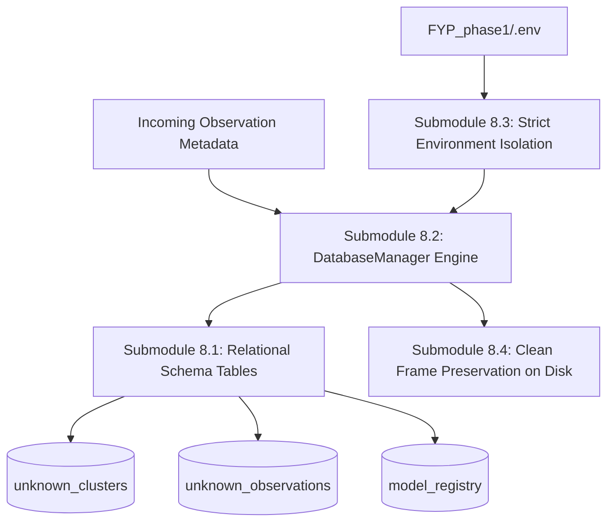

# Module 8: Relational Metadata & Observation Store

## 1. Executive Summary & Purpose

Module 8 provides the **durable relational backbone** of the entire surveillance system across **Phase 2** and **Phase 3**.

Whenever an unknown physical object is extracted, decomposed, and clustered, Module 8 persists:
1. The mapping between FAISS cluster vectors and database cluster records.
2. The observation paths on disk (clean full CCTV frames, isolated raw crops, and neighbor-masked crops).
3. The exact spatial bounding boxes, frame dimensions, and Laplacian sharpness scores.
4. The complete audit log and metric history of every retrained YOLO model version.

---

## 2. Submodule Breakdown

Module 8 is implemented in [module_8/](file:///Users/mayur/Documents/NEW_FYP/module_8/):



### Submodule 8.1: Relational Schema Architecture (`schema.sql`)
- **Source File:** [schema.sql](file:///Users/mayur/Documents/NEW_FYP/schema.sql)
- **Table 1: `unknown_clusters`**
  Tracks high-level cluster state and VLM discovery outcomes:
  ```sql
  CREATE TABLE IF NOT EXISTS unknown_clusters (
      cluster_id SERIAL PRIMARY KEY,
      faiss_index_id INT UNIQUE NOT NULL,
      observation_count INT NOT NULL DEFAULT 1,
      status VARCHAR(32) NOT NULL DEFAULT 'COLLECTING',
      identified_label VARCHAR(128) DEFAULT NULL,
      assigned_yolo_class_id INT DEFAULT NULL,
      vlm_confidence FLOAT DEFAULT NULL,
      vlm_reasoning TEXT DEFAULT NULL,
      created_at TIMESTAMP DEFAULT CURRENT_TIMESTAMP,
      updated_at TIMESTAMP DEFAULT CURRENT_TIMESTAMP
  );
  ```
  - **Lifecycle States:** `COLLECTING` $\rightarrow$ `IDENTIFIED` $\rightarrow$ `RETRAINING` $\rightarrow$ `DEPLOYED_IN_YOLO` (or `NOISE`).

- **Table 2: `unknown_observations`**
  Stores individual physical sightings with image references:
  ```sql
  CREATE TABLE IF NOT EXISTS unknown_observations (
      observation_id SERIAL PRIMARY KEY,
      cluster_id INT NOT NULL REFERENCES unknown_clusters(cluster_id) ON DELETE CASCADE,
      track_id INT NOT NULL,
      sub_object_idx INT NOT NULL DEFAULT 0,
      crop_image_path TEXT NOT NULL,
      masked_crop_path TEXT NOT NULL,
      full_frame_path TEXT NOT NULL,
      bbox_xyxy INT[4] NOT NULL,
      frame_hw INT[2] NOT NULL,
      sharpness_score FLOAT NOT NULL,
      cosine_similarity FLOAT NOT NULL,
      decomposition_method VARCHAR(32) NOT NULL,
      captured_at TIMESTAMP DEFAULT CURRENT_TIMESTAMP
  );
  CREATE INDEX IF NOT EXISTS idx_cluster_sharpness 
  ON unknown_observations(cluster_id, sharpness_score DESC);
  ```

- **Table 3: `model_registry`**
  Maintains model governance, lineage, and validation metrics:
  ```sql
  CREATE TABLE IF NOT EXISTS model_registry (
      model_version_id SERIAL PRIMARY KEY,
      weights_path TEXT NOT NULL,
      num_classes INT NOT NULL,
      class_names_json TEXT NOT NULL,
      old_classes_map50_95 FLOAT NOT NULL,
      new_class_map50 FLOAT NOT NULL,
      new_class_recall FLOAT NOT NULL,
      promoted_to_production BOOLEAN NOT NULL DEFAULT FALSE,
      trained_on_cluster_id INT REFERENCES unknown_clusters(cluster_id),
      created_at TIMESTAMP DEFAULT CURRENT_TIMESTAMP
  );
  ```

### Submodule 8.2: DatabaseManager (Dual PostgreSQL + SQLite Fallback Engine)
- **Source File:** [db_manager.py](file:///Users/mayur/Documents/NEW_FYP/module_8/db_manager.py#L25-L95)
- **Dual-Backend Support:**
  - Production utilizes PostgreSQL via `psycopg2` for high-concurrency client connections and JSON querying.
  - Development and isolated CI environments automatically fail over to SQLite (`outputs/surveillance_discovery.db`) with zero code alterations if PostgreSQL is unavailable.

### Submodule 8.3: Strict Environment Isolation (`FYP_phase1/.env` Zero-Coupling Rule)
- **Source File:** [config.py](file:///Users/mayur/Documents/NEW_FYP/module_8/config.py#L20-L55)
- **Strict Rule:**
  - Database credentials (`POSTGRES_HOST`, `POSTGRES_PORT`, `POSTGRES_DB`, `POSTGRES_USER`, `POSTGRES_PASSWORD`) and `GEMINI_API_KEY` are loaded **strictly from `../FYP_phase1/.env`** via `python-dotenv`.
  - The pipeline **never imports, executes, or references any code or Python files inside `FYP_phase1`**, guaranteeing absolute zero coupling between projects.

### Submodule 8.4: Clean Frame Preservation Guarantee
- **Source Files:** [pipeline_12_modules.py](file:///Users/mayur/Documents/NEW_FYP/pipeline_12_modules.py#L108-L116)
- **Why This Is Crucial:**
  Surveillance frames stored on disk (`storage/frames/`) must remain **100% clean and unannotated**. If a bounding box or red contour is drawn on the disk image, the subsequent YOLO retraining in Module 10 will learn the red line as a visual feature of the object, causing severe test-time failure. Module 8 guarantees that all frames saved to disk are pristine.

---

## 3. Configuration & Parameter Reference

Configuration is managed via dataclass in [module_8/config.py](file:///Users/mayur/Documents/NEW_FYP/module_8/config.py):

| Parameter | Type | Default | Description |
|---|---|---|---|
| `postgres_dsn` | `str` | Autogenerated from `.env` | PostgreSQL connection string. |
| `use_sqlite_fallback` | `bool` | `True` | Fallback flag if PostgreSQL server is offline. |
| `sqlite_db_path` | `str` | `"outputs/surveillance_discovery.db"` | Local SQLite database filepath. |

---

## 4. Key Database Methods Reference

```python
# Insert a new cluster with its corresponding FAISS ID
cluster_id, obs_count, status = db.insert_cluster(faiss_index_id=0)

# Increment cluster observation count
cluster_id, obs_count, status = db.increment_cluster(faiss_index_id=0)

# Insert detailed sighting observation
db.insert_observation(
    cluster_id=cluster_id,
    track_id=track_id,
    crop_image_path="storage/crops/track_1_sub_0.jpg",
    masked_crop_path="storage/masked_crops/track_1_sub_0.jpg",
    full_frame_path="storage/frames/track_1_sub_0.jpg",
    bbox_xyxy=[x1, y1, x2, y2],
    frame_hw=[1080, 1920],
    sharpness_score=142.5,
    cosine_similarity=0.88,
    decomposition_method="METHOD2_FASTSAM_DINOV2"
)

# Query top sharpest observations for VLM or Dataset Builder
records = db.get_cluster_observations(cluster_id=1, limit=100)
```

---

## 5. Code Verification & Standalone Execution

Module 8 is verified via test suite in `tests/test_module_8_db.py`:

```bash
pytest tests/test_module_8_db.py -v
```
