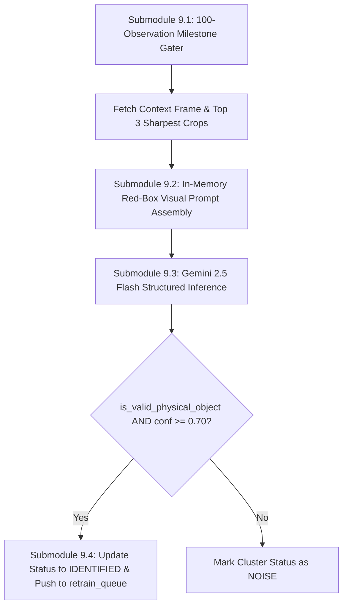

# Module 9: Automated VLM Discovery Trigger (Gemini 2.5 Flash)

## 1. Executive Summary & Purpose

Module 9 bridges the gap between **unsupervised numerical clustering** and **human-understandable semantic object identification**.

Once an unknown cluster accumulates sufficient empirical evidence (**100 confirmed observations** in PostgreSQL), Module 9 automatically summons a state-of-the-art multimodal Vision-Language Model (**Google Gemini 2.5 Flash**). 

The VLM evaluates the physical entity within its wide contextual scene alongside its sharpest close-up crops, determines if it is a genuine physical moving object, and assigns a standardized, canonical class name (e.g., `"bicycle"`, `"forklift"`, `"dog"`). Confirmed physical discoveries are dispatched to **Phase 3** for continual model retraining.

---

## 2. Submodule Breakdown

Module 9 is implemented in [module_9/](file:///Users/mayur/Documents/NEW_FYP/module_9/):



### Submodule 9.1: 100-Observation Milestone Gating
- **Source File:** [vlm_identifier.py](file:///Users/mayur/Documents/NEW_FYP/module_9/vlm_identifier.py#L40-L65)
- **Why 100 Observations:**
  - Querying a cloud VLM on every unknown frame would be prohibitively slow and expensive.
  - Waiting for 100 independent track observations guarantees statistical robustness: a fleeting shadow or transient reflection will never survive 100 distinct Kalman-gated tracks.
- **Trigger Logic:**
  ```python
  def should_trigger(self, obs_count: int, status: str) -> bool:
      return obs_count >= self.config.trigger_count and status == "COLLECTING"
  ```

### Submodule 9.2: Multi-Crop Contextual Visual Prompt Construction
- **Source File:** [vlm_identifier.py](file:///Users/mayur/Documents/NEW_FYP/module_9/vlm_identifier.py#L70-L115)
- **Visual Composition (Context + Close-ups):**
  1. Queries PostgreSQL for the **single sharpest full scene frame** and the **top 3 sharpest isolated sub-object crops**.
  2. **In-Memory Red Bounding Box (Pristine Disk Rule):**
     To show Gemini where the object is located in the wide CCTV scene, Module 9 creates an **in-memory copy** of the full frame and draws a 3-pixel red box with label around `bbox_xyxy`:
     ```python
     vis_frame = full_frame_bgr.copy() # IN-MEMORY CLONE ONLY
     cv2.rectangle(vis_frame, (x1, y1), (x2, y2), (0, 0, 255), 3)
     ```
     **The disk file is NEVER touched.** This prevents data contamination during YOLO retraining.
  3. Prepares a multi-part PIL image list containing:
     - `[Image 1]`: Wide contextual CCTV scene with red box.
     - `[Image 2]`: Sharpest raw crop #1.
     - `[Image 3]`: Sharpest raw crop #2.
     - `[Image 4]`: Sharpest masked crop #3 (with neighbor suppression).

### Submodule 9.3: Gemini 2.5 Flash Structured JSON Output Contract
- **Source File:** [vlm_identifier.py](file:///Users/mayur/Documents/NEW_FYP/module_9/vlm_identifier.py#L20-L45)
- **Schema Enforcement:**
  Utilizes the new Google GenAI SDK (`google-genai`) with strict Pydantic JSON schema:
  ```python
  class GeminiObjectSchema(BaseModel):
      object_name: str = Field(description="Specific physical object name discovered (e.g. 'bicycle', 'person', 'forklift')")
      category: str = Field(description="High-level category (e.g. 'vehicle', 'animal', 'equipment', 'human')")
      is_valid_physical_object: bool = Field(description="True if genuine moving physical object, False if noise/shadow")
      confidence: float = Field(description="Confidence score between 0.0 and 1.0")
      reasoning: str = Field(description="Step-by-step reasoning based on context, scale, and appearance")
  ```
- **Inference Call:**
  ```python
  response = client.models.generate_content(
      model="gemini-2.5-flash",
      contents=[prompt_text, vis_pil, crop1_pil, crop2_pil, crop3_pil],
      config=types.GenerateContentConfig(
          response_mime_type="application/json",
          response_schema=GeminiObjectSchema,
          temperature=0.1
      )
  )
  ```

### Submodule 9.4: Cluster Identification & Phase 3 Queue Dispatch
- **Source File:** [vlm_identifier.py](file:///Users/mayur/Documents/NEW_FYP/module_9/vlm_identifier.py#L120-L160)
- **Decision Engine:**
  - If `is_valid_physical_object == True` and `confidence >= 0.70`:
    1. Updates PostgreSQL:
       $$\text{status} = \text{'IDENTIFIED'}, \quad \text{identified\_label} = \text{result.object\_name}$$
    2. Pushes `cluster_id` into Phase 3's asynchronous `retrain_queue`:
       ```python
       retrain_queue.put(cluster_id)
       ```
  - If `is_valid_physical_object == False`:
    - Updates PostgreSQL status to `'NOISE'`, suppressing further processing.

---

## 3. Configuration & Parameter Reference

Configuration is managed via dataclass in [module_9/config.py](file:///Users/mayur/Documents/NEW_FYP/module_9/config.py):

| Parameter | Type | Default | Description |
|---|---|---|---|
| `trigger_count` | `int` | `100` | Number of observations required to invoke Gemini. |
| `min_confidence` | `float` | `0.70` | Minimum VLM confidence required to proceed to retraining. |
| `model_name` | `str` | `"gemini-2.5-flash"` | Gemini model identifier. |
| `api_key` | `str` | Loaded from `.env` | `GEMINI_API_KEY` from `FYP_phase1/.env`. |

---

## 4. Input / Output Data Specifications

### Input
- **`cluster_id`**: Integer ID of the cluster reaching 100 observations.
- **`db`**: DatabaseManager instance.
- **`retrain_queue`**: `multiprocessing.Queue` to Phase 3.

### Output (Stored in Database & Pushed to Queue)
- **`identified_label`**: Canonical name (e.g., `"bicycle"`).
- **`vlm_confidence`**: Float confidence score (e.g., `0.94`).
- **`vlm_reasoning`**: Natural language chain-of-thought justification.
- **`retrain_queue` message**: Integer `cluster_id` forwarded to Module 10.

---

## 5. Failure Modes & Edge Case Mitigations

| Failure Mode | Physical Cause | Mitigation in Module 9 |
|---|---|---|
| **API Rate Limiting / Network Interruption** | Temporary cloud outage during VLM call. | Handled with exponential backoff try-catch. Status remains `COLLECTING` until successful query. |
| **Hallucination on Ambiguous Reflections** | Wet asphalt creates distorted reflection. | Gemini uses full contextual frame to evaluate physical scale and height above ground. Flags `is_valid_physical_object = False`. |
| **Object Renaming Variation** | Gemini identifies "bike" instead of "bicycle". | Handled downstream by Module 10's semantic string normalization and class alias mapping dictionary. |

---

## 6. Code Verification & Mock Testing

Module 9 is tested with both live and mock credentials in `tests/test_module_9_vlm.py`:

```bash
pytest tests/test_module_9_vlm.py -v
```
