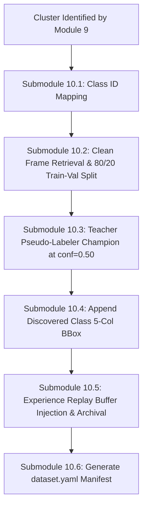

# Module 10: Continual Dataset Builder & Teacher Pseudo-Labeler

## 1. Executive Summary & Purpose

Module 10 initiates **Phase 3 (Continual Retraining & Evolution Worker)**. It automates the preparation of a complete, production-grade Ultralytics YOLO bounding-box dataset whenever an unknown cluster is confirmed by Module 9.

### The Two Dual Catastrophes Solved
Naively training an object detector on newly collected frames introduces two catastrophic failure modes:

1. **Unlabeled Foreground Suppression:**
   In real CCTV surveillance, when an unknown bicycle appears, known cars and pedestrians are frequently visible in the background of the same frame. If the training label file *only* annotates the new bicycle, **the YOLO loss function treats all unannotated cars and people as background ($y=0$), penalizing the neural network for detecting known classes**.
2. **Catastrophic Forgetting:**
   Training weights solely on newly captured data causes dramatic weight drift, destroying the detector's representation of previously learned classes.

Module 10 solves both problems autonomously using **Teacher Pseudo-Labeling** (running the active Champion model on clean frames to label co-occurring known objects) and **Experience Replay Injection** (mixing in historical exemplars).

---

## 2. Submodule Breakdown

Module 10 is implemented in [module_10/](file:///Users/mayur/Documents/NEW_FYP/module_10/):



### Submodule 10.1: Sequential Class ID Mapping & Alias Resolution
- **Source File:** [dataset_builder.py](file:///Users/mayur/Documents/NEW_FYP/module_10/dataset_builder.py#L50-L75)
- **Class Catalog Resolution:**
  1. Inspects the active `champion_latest.pt` model's class dictionary:
     $$\mathcal{C}_{\text{existing}} = \{0: \text{'person'}, 1: \text{'bicycle'}, \dots, K-1: \text{'label'}\}$$
  2. Normalizes the new label string: `label_clean = identified_label.strip().lower()`.
  3. If `label_clean` matches an existing class alias, maps to that class ID.
  4. Otherwise, allocates the next sequential index:
     $$\text{new\_cls\_id} = \max(\mathcal{C}_{\text{existing}}.\text{keys}()) + 1$$
     $$\mathcal{C}_{\text{updated}} = \mathcal{C}_{\text{existing}} \cup \{\text{new\_cls\_id}: \text{label\_clean}\}$$

### Submodule 10.2: Clean Full Frame Retrieval & 80/20 Train-Val Splitting
- **Source File:** [dataset_builder.py](file:///Users/mayur/Documents/NEW_FYP/module_10/dataset_builder.py#L76-L100)
- **Dataset Hierarchy Creation:**
  Creates an isolated training workspace:
  ```text
  storage/datasets/cluster_{id}/
  ├── dataset.yaml
  ├── images/
  │   ├── train/ (80 clean full frames)
  │   └── val/   (20 clean full frames)
  └── labels/
      ├── train/ (80 text annotation files)
      └── val/   (20 text annotation files)
  ```
- **Stratified Sharpness Splitting:**
  Retrieves all 100 observations sorted by `sharpness_score DESC`. The first 80 frames (80%) populate `train/`, and the remaining 20 frames (20%) populate `val/`.

### Submodule 10.3: Teacher Pseudo-Labeling of Co-Occurring Known Objects
- **Source File:** [dataset_builder.py](file:///Users/mayur/Documents/NEW_FYP/module_10/dataset_builder.py#L101-L125)
- **Mathematical Conversion to Standard YOLO Format:**
  Runs the active Champion YOLO model at `conf = 0.50` on each clean full frame. For every detected known object $k$ with bounding box $[tx_1, ty_1, tx_2, ty_2]$ in frame $(fw, fh)$:
  $$x_c = \text{clip}\left(\frac{tx_1 + tx_2}{2 \cdot fw}, 0, 1\right), \quad y_c = \text{clip}\left(\frac{ty_1 + ty_2}{2 \cdot fh}, 0, 1\right)$$
  $$w = \text{clip}\left(\frac{tx_2 - tx_1}{fw}, 0, 1\right), \quad h = \text{clip}\left(\frac{ty_2 - ty_1}{fh}, 0, 1\right)$$
  Formats standard 5-column YOLO label lines:
  ```text
  <cls_id> <x_center> <y_center> <width> <height>
  ```
  *(Excludes any classes currently in `HOLDOUT_CLASS_IDS` during benchmark tests).*

### Submodule 10.4: Discovered Novel Object 5-Column Annotation
- **Source File:** [dataset_builder.py](file:///Users/mayur/Documents/NEW_FYP/module_10/dataset_builder.py#L126-L135)
- **Operation:**
  Takes the true discovered bounding box $[bx_1, by_1, bx_2, by_2]$ recorded in PostgreSQL, normalizes to $(x_c, y_c, w, h)$, and appends it to the label file under `new_cls_id`.
- **Result:** Every image now has full supervision: all co-occurring known objects are preserved, and the new object is explicitly labeled.

### Submodule 10.5: Experience Replay Buffer Injection & Archival
- **Source File:** [dataset_builder.py](file:///Users/mayur/Documents/NEW_FYP/module_10/dataset_builder.py#L136-L155)
- **Long-Term Memory Buffer (`storage/replay_buffer/`):**
  1. **Archival:** Saves the top 20 sharpest image/label pairs from the current cluster into `storage/replay_buffer/images/` and `labels/` to protect this new class during future retraining cycles.
  2. **Injection:** Injects existing historical exemplars from previous discovery cycles into the current `train/` and `val/` splits (80/20 ratio) to guarantee stability across multiple generations of model evolution.

### Submodule 10.6: Autonomous `dataset.yaml` Manifest Generation
- **Source File:** [dataset_builder.py](file:///Users/mayur/Documents/NEW_FYP/module_10/dataset_builder.py#L156-L160)
- **Manifest Content:**
  ```yaml
  path: /Users/mayur/Documents/NEW_FYP/storage/datasets/cluster_1
  train: images/train
  val: images/val
  names:
    0: person
    1: bicycle
    2: car
    ...
    80: forklift
  ```

---

## 3. Configuration & Parameter Reference

Configuration is managed via dataclass in [module_10/config.py](file:///Users/mayur/Documents/NEW_FYP/module_10/config.py):

| Parameter | Type | Default | Description |
|---|---|---|---|
| `train_split_ratio` | `float` | `0.80` | Proportion of frames assigned to training set. |
| `teacher_conf` | `float` | `0.50` | Confidence threshold for Teacher pseudo-labeler. |
| `replay_buffer_dir` | `str` | `"storage/replay_buffer"` | Directory for long-term historical exemplars. |
| `dataset_root_dir` | `str` | `"storage/datasets"` | Root output directory for incremental datasets. |

---

## 4. Input / Output Data Specifications

### Input
- **`cluster_id`**: Integer ID of identified cluster.
- **`champion_weights_path`**: Filepath to active `champion_latest.pt`.
- **`db`**: DatabaseManager instance.

### Output: `Tuple[Path, List[int], int, str]`
- **`dataset_yaml_path`**: Absolute path to self-contained `dataset.yaml`.
- **`old_class_ids`**: List of existing integer class IDs (used for retention gating).
- **`target_cls_id`**: Assigned integer class ID of the new class.
- **`new_label_name`**: Clean string label of the new class.

---

## 5. Code Verification & Standalone Execution

Module 10 is tested in `tests/test_module_10_dataset.py`:

```bash
pytest tests/test_module_10_dataset.py -v
```
