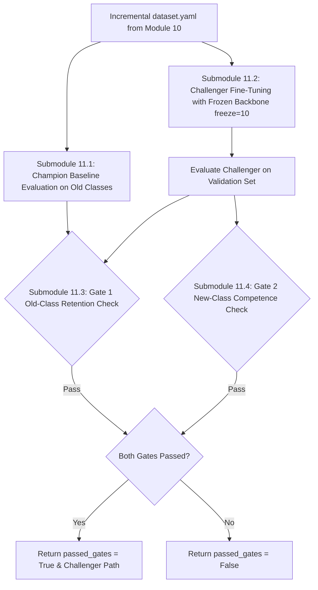

# Module 11: Incremental YOLO Trainer & Metric Gate

## 1. Executive Summary & Purpose

Module 11 forms the **rigorous validation gatekeeper** of **Phase 3**.

In automated machine learning (AutoML) and continuous learning, deploying a newly trained model directly into production without validation is dangerous. A fine-tuned model could easily suffer from:
1. **Catastrophic Forgetting:** Regressing on previously known classes.
2. **Underfitting / Poor Generalization:** Failing to achieve sufficient detection accuracy on the newly discovered class.

Module 11 solves this by implementing an automated **Champion-vs-Challenger Evaluation Protocol**:
- It fine-tunes a **Challenger model** with frozen backbone layers (`freeze=10`).
- It measures the baseline performance of the existing **Champion model** on old classes.
- It validates the Challenger against **two mathematical gates** before permitting deployment.

---

## 2. Submodule Breakdown

Module 11 is implemented in [module_11/](file:///Users/mayur/Documents/NEW_FYP/module_11/):



### Submodule 11.1: Champion Baseline Old-Class mAP Evaluation
- **Source File:** [trainer_evaluator.py](file:///Users/mayur/Documents/NEW_FYP/module_11/trainer_evaluator.py#L40-L60)
- **Baseline Metric Calculation:**
  Evaluates the current `champion_latest.pt` on the newly constructed validation split:
  ```python
  champ_val = champion_model.val(data=str(dataset_yaml_path), split="val", verbose=False)
  ```
  Extracts the baseline mean Average Precision across all historical known classes $\mathcal{C}_{\text{old}}$:
  $$\text{mAP}_{50\text{-}95}^{\text{old}}(\text{Champion}) = \frac{1}{|\mathcal{C}_{\text{old}}|} \sum_{c \in \mathcal{C}_{\text{old}}} \text{AP}_{50\text{-}95}(c)$$

### Submodule 11.2: Challenger Fine-Tuning with Frozen Backbone (`freeze=10`)
- **Source File:** [trainer_evaluator.py](file:///Users/mayur/Documents/NEW_FYP/module_11/trainer_evaluator.py#L61-L85)
- **Why `freeze=10` is Essential:**
  The first 10 layers of YOLO contain the general spatial feature extractors (edges, textures, basic geometric primitives). Freezing these layers:
  1. Prevents gradient backpropagation from destroying general visual representations.
  2. Accelerates training speed by $\sim 40\%$.
  3. Concentrates learning on the head layers responsible for bounding-box regression and novel class classification.
- **Training Command:**
  ```python
  challenger_trainer.train(
      data=str(dataset_yaml_path),
      epochs=25,
      imgsz=640,
      batch=16,
      freeze=10,
      lr0=0.001,
      patience=7,
      project="models/runs",
      name=f"challenger_cluster_{cluster_id}"
  )
  ```

### Submodule 11.3: Gate 1 – Catastrophic Forgetting & Old-Class Retention Check
- **Source File:** [trainer_evaluator.py](file:///Users/mayur/Documents/NEW_FYP/module_11/trainer_evaluator.py#L90-L115)
- **Mathematical Constraint:**
  $$\Delta \text{mAP}_{\text{old}} = \text{mAP}_{50\text{-}95}^{\text{old}}(\text{Challenger}) - \text{mAP}_{50\text{-}95}^{\text{old}}(\text{Champion}) \ge -0.015$$
- **Policy:** The Challenger model's performance on existing known classes is **never allowed to drop by more than 1.5%** ($\Delta \le -0.015$). If regression exceeds 1.5%, Gate 1 fails instantly.

### Submodule 11.4: Gate 2 – New-Class Competence & Recall Check
- **Source File:** [trainer_evaluator.py](file:///Users/mayur/Documents/NEW_FYP/module_11/trainer_evaluator.py#L116-L135)
- **Mathematical Constraints:**
  $$\text{mAP}_{50}^{\text{new}}(\text{Challenger}) \ge \text{MIN\_NEW\_CLASS\_MAP50} = 0.60 \; (60\%)$$
  $$\text{Recall}^{\text{new}}(\text{Challenger}) \ge \text{MIN\_NEW\_CLASS\_RECALL} = 0.65 \; (65\%)$$
- **Policy:** The Challenger must demonstrate that it has actually mastered the newly discovered object with at least 60% mAP50 and 65% recall.

---

## 3. Configuration & Parameter Reference

Configuration is managed via dataclass in [module_11/config.py](file:///Users/mayur/Documents/NEW_FYP/module_11/config.py):

| Parameter | Type | Default | Description | Impact of Tuning |
|---|---|---|---|---|
| `epochs` | `int` | `25` | Training epochs for Challenger fine-tuning. | Higher: Better convergence; Lower: Faster cycle. |
| `freeze_layers` | `int` | `10` | Number of backbone layers frozen during training. | Must remain 10 to prevent feature disruption. |
| `lr0` | `float` | `0.001` | Initial learning rate. | Conservative learning rate prevents weight explosion. |
| `max_old_map_drop` | `float` | `0.015` | Maximum allowable drop in old-class mAP50-95 (1.5%). | Prevents catastrophic forgetting. |
| `min_new_map50` | `float` | `0.60` | Minimum mAP50 required on new class (60%). | Enforces detection competence. |
| `min_new_recall` | `float` | `0.65` | Minimum recall required on new class (65%). | Enforces high object coverage. |

---

## 4. Input / Output Data Specifications

### Input
- **`champion_weights_path`**: Path to active production model.
- **`dataset_yaml_path`**: Path to dataset manifest from Module 10.
- **`old_class_ids`**: List of existing class indices.
- **`target_cls_id`**: Index of the newly discovered class.
- **`cluster_id`**: Integer ID of the cluster.

### Output: `Tuple[bool, Path, Dict[str, Any]]`
- **`passed_gates`**: Boolean (`True` if both Gate 1 and Gate 2 were satisfied).
- **`challenger_weights_path`**: Path to `models/runs/.../weights/best.pt`.
- **`metrics`**: Dictionary containing:
  ```python
  {
      "champ_old_map": float,
      "chal_old_map": float,
      "new_cls_map50": float,
      "new_cls_recall": float,
      "passed_old_retention": bool,
      "passed_new_competence": bool
  }
  ```

---

## 5. Code Verification & Standalone Execution

Module 11 is tested in `tests/test_module_11_trainer.py`:

```bash
pytest tests/test_module_11_trainer.py -v
```
