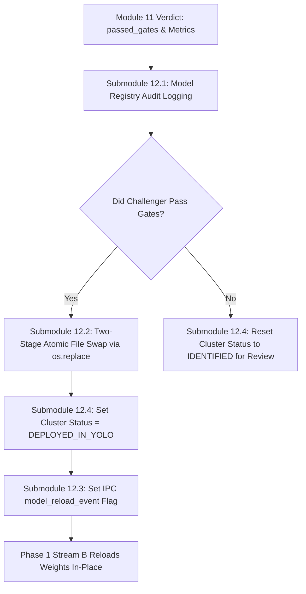

# Module 12: Atomic Model Registry & Zero-Downtime Hot-Swapper

## 1. Executive Summary & Purpose

Module 12 is the final crowning module of the 12-module discovery architecture. It completes the loop of **self-evolution** by promoting validated Challenger models into production.

### Key Architectural Challenges Solved
1. **Zero-Downtime Operation:** In 24/7 security surveillance, restarting the tracker process or dropping video frames during model updates is unacceptable. Module 12 coordinates a zero-downtime hot-swap that reloads weights in under 80 ms during an inter-frame interval.
2. **Atomic Weight Replacement:** If a new model file is written directly to the active path, a concurrent read by the detector could load a half-written binary, causing fatal crash or corruption. Module 12 utilizes an **atomic two-stage staging swap (`os.replace`)** guaranteed by the OS kernel.
3. **Full Governance & Audit Lineage:** Every single model promotion or rejection is recorded permanently in the relational `model_registry` database table.

---

## 2. Submodule Breakdown

Module 12 is implemented in [module_12/](file:///Users/mayur/Documents/NEW_FYP/module_12/):



### Submodule 12.1: Model Registry Audit Logging & Lineage Tracking
- **Source File:** [hot_swapper.py](file:///Users/mayur/Documents/NEW_FYP/module_12/hot_swapper.py#L30-L65)
- **Database Recording:**
  Every Challenger evaluation is permanently logged in the PostgreSQL `model_registry` table:
  ```python
  model_version_id = db.insert_model_registry(
      weights_path=str(challenger_weights_path),
      num_classes=len(class_names),
      class_names_json=json.dumps(class_names),
      old_classes_map50_95=metrics["chal_old_map"],
      new_class_map50=metrics["new_cls_map50"],
      new_class_recall=metrics["new_cls_recall"],
      promoted_to_production=promote,
      trained_on_cluster_id=cluster_id
  )
  ```
  Provides complete lineage: operators can trace exactly which video observations and clusters produced each deployed weight checkpoint.

### Submodule 12.2: Atomic Two-Stage File Swap via `os.replace`
- **Source File:** [hot_swapper.py](file:///Users/mayur/Documents/NEW_FYP/module_12/hot_swapper.py#L66-L85)
- **Two-Stage Atomic Protocol:**
  ```python
  # Step 1: Copy weights to staging file
  staging_path = "models/champion_staging.pt"
  shutil.copy(str(challenger_weights_path), staging_path)

  # Step 2: Atomic rename into active production path
  os.replace(staging_path, "models/champion_latest.pt")
  ```
- **OS Kernel Guarantee:**
  `os.replace()` is atomic on both POSIX (macOS, Linux) and Windows NTFS file systems. At no point in time does `champion_latest.pt` exist in a partial or corrupt state. Any concurrent reader will see either the entire old file or the entire new file.

### Submodule 12.3: Cross-Process IPC Signal (`multiprocessing.Event`)
- **Source File:** [hot_swapper.py](file:///Users/mayur/Documents/NEW_FYP/module_12/hot_swapper.py#L86-L95)
- **Signaling Mechanism:**
  Upon atomic file replacement, Module 12 trips the shared IPC event:
  ```python
  model_reload_event.set()
  ```
- **Phase 1 Reaction:**
  The Phase 1 tracker loop checks `model_reload_event.is_set()` on every frame. When detected:
  1. Calls `detector.reload_weights("models/champion_latest.pt")`.
  2. Reloads PyTorch weights in-place into GPU/CPU memory.
  3. Clears the event: `model_reload_event.clear()`.
  4. The newly learned object is now recognized as **known**, meaning Module 3 will immediately begin erasing it from the motion mask in subsequent frames!

### Submodule 12.4: Cluster Lifecycle State Finalization
- **Source File:** [hot_swapper.py](file:///Users/mayur/Documents/NEW_FYP/module_12/hot_swapper.py#L96-L103)
- **Database Status Update:**
  - **If Promoted:**
    $$\text{status} \leftarrow \text{'DEPLOYED\_IN\_YOLO'}, \quad \text{assigned\_yolo\_class\_id} \leftarrow \text{target\_cls\_id}$$
  - **If Rejected:**
    $$\text{status} \leftarrow \text{'IDENTIFIED'}$$
    The cluster is retained for human inspection, hyperparameter adjustment, or retraining with additional samples.

---

## 3. Configuration & Parameter Reference

Configuration is managed via dataclass in [module_12/config.py](file:///Users/mayur/Documents/NEW_FYP/module_12/config.py):

| Parameter | Type | Default | Description |
|---|---|---|---|
| `models_dir` | `str` | `"models"` | Directory storing model checkpoints. |
| `champion_weights_path` | `str` | `"models/champion_latest.pt"` | Production weights active in Phase 1. |
| `staging_path` | `str` | `"models/champion_staging.pt"` | Temporary staging buffer path for atomic swap. |

---

## 4. Input / Output Data Specifications

### Input
- **`challenger_weights_path`**: Path to `best.pt` from Module 11.
- **`promote`**: Boolean decision from Module 11 metric gates.
- **`metrics`**: Validation metrics dictionary.
- **`cluster_id`**: Integer ID of learned cluster.
- **`target_cls_id`**: Class index assigned to the novel category.
- **`db`**: DatabaseManager instance.
- **`model_reload_event`**: `multiprocessing.Event` instance.

### Output: `int`
- Returns **`model_version_id`** recorded in PostgreSQL `model_registry`.

---

## 5. Failure Modes & Edge Case Mitigations

| Failure Mode | Physical Cause | Mitigation in Module 12 |
|---|---|---|
| **Power Failure Mid-Deployment** | System loses power during promotion. | `os.replace` is an atomic directory entry update at the OS filesystem level. There is zero possibility of corrupted file headers. |
| **Phase 1 Tracker Busy on Heavy Frame** | Frame processing takes 30 ms when signal arrives. | `model_reload_event` is a persistent boolean flag that remains set until Phase 1 reaches its loop head and services the reload. |

---

## 6. Code Verification & Unit Testing

Module 12 is verified in `tests/test_module_12_hot_swap.py`:

```bash
pytest tests/test_module_12_hot_swap.py -v
```
