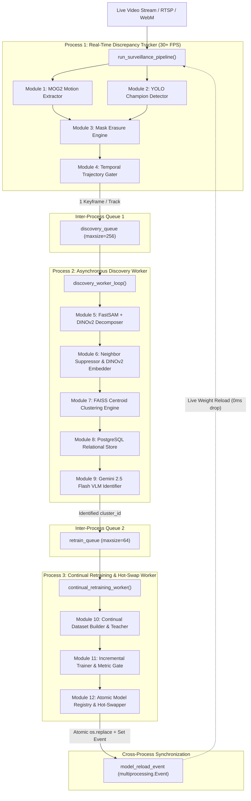

# Pipeline Orchestration & Multiprocessing Architecture

## 1. Executive Summary & Purpose

The **12-Module Continual Discovery & Retraining Engine** is orchestrated across **three concurrent OS multiprocessing processes**.

In real-world computer vision, high-speed video capture and frame processing (30+ FPS) cannot share the same execution thread or Python Global Interpreter Lock (GIL) with computationally heavy deep learning inference (FastSAM, DINOv2, Gemini VLM) or neural network backpropagation (YOLO fine-tuning). 

By splitting the system into three decoupled multiprocessing processes interconnected via asynchronous memory queues and IPC events, the system achieves:
1. **Uninterrupted 30+ FPS Surveillance:** Phase 1 never stalls, even when Phase 3 is fine-tuning YOLO for several minutes on the GPU.
2. **Backpressure Isolation:** Slow downstream VLM API calls or database writes do not impact real-time tracking.
3. **Fault Isolation:** An exception in downstream clustering or retraining cannot crash the primary surveillance stream.

---

## 2. Multiprocessing Architecture Diagram



---

## 3. Detailed Process Breakdown

### Phase 1: Real-Time Discrepancy Tracker Process
- **Entry Function:** `run_surveillance_pipeline(video_path, max_frames)`
- **Source File:** [pipeline_12_modules.py](file:///Users/mayur/Documents/NEW_FYP/pipeline_12_modules.py#L205-L289)
- **Active Modules:** Module 1, Module 2, Module 3, Module 4.
- **Responsibilities:**
  - Reads frames sequentially from OpenCV `VideoCapture`.
  - Checks `model_reload_event.is_set()` at loop start. If tripped, reloads `champion_latest.pt` in-place and clears the flag.
  - Generates MOG2 binary motion mask (Module 1).
  - Detects known objects with YOLO (Module 2).
  - Subtracts known objects with 15px dilation from motion mask (Module 3).
  - Updates Kalman trajectories, verifies directional persistence, and extracts the sharpest keyframe (Module 4).
  - Dispatches completed track keyframes to `discovery_queue`.
- **Target Performance:** $\ge 30\text{ FPS}$ on standard surveillance resolutions.

### Phase 2: Asynchronous Discovery Worker Process
- **Entry Function:** `discovery_worker_loop(discovery_queue, retrain_queue)`
- **Source File:** [pipeline_12_modules.py](file:///Users/mayur/Documents/NEW_FYP/pipeline_12_modules.py#L63-L146)
- **Active Modules:** Module 5, Module 6, Module 7, Module 8, Module 9.
- **Responsibilities:**
  - Blocks on `discovery_queue.get()`.
  - Decomposes compound silhouettes into isolated sub-objects (Module 5).
  - Suppresses background/neighbor pixels to gray 128 and extracts 384-D DINOv2 vector (Module 6).
  - Saves pristine clean full frames, crops, and masked crops to disk (Module 8).
  - Matches or creates FAISS cluster centroids and syncs to disk (Module 7).
  - Increments observation counts in PostgreSQL (Module 8).
  - Evaluates 100-count milestone and invokes Gemini 2.5 Flash with structured schema (Module 9).
  - If verified as a valid novel physical object, pushes `cluster_id` to `retrain_queue`.

### Phase 3: Continual Retraining & Hot-Swap Worker Process
- **Entry Function:** `continual_retraining_worker(retrain_queue, model_reload_event)`
- **Source File:** [pipeline_12_modules.py](file:///Users/mayur/Documents/NEW_FYP/pipeline_12_modules.py#L148-L203)
- **Active Modules:** Module 10, Module 11, Module 12.
- **Responsibilities:**
  - Blocks on `retrain_queue.get()`.
  - Updates cluster status to `RETRAINING`.
  - Builds incremental YOLO dataset with Teacher pseudo-labeling and experience replay (Module 10).
  - Fine-tunes Challenger model (`freeze=10`) and verifies Gate 1 and Gate 2 metrics (Module 11).
  - Logs model lineage in PostgreSQL (Module 12).
  - If passed, stages and atomically replaces `models/champion_latest.pt` and sets `model_reload_event.set()` (Module 12).

---

## 4. Inter-Process Communication (IPC) Specifications

| IPC Primitive | Type | Capacity | Producers | Consumers | Purpose |
|---|---|---|---|---|---|
| `discovery_queue` | `multiprocessing.Queue` | `256` items | Phase 1 (Module 4) | Phase 2 (Module 5) | Streams confirmed track keyframe tuples (clean frame, crops, bounding box, sharpness). |
| `retrain_queue` | `multiprocessing.Queue` | `64` items | Phase 2 (Module 9) | Phase 3 (Module 10) | Streams confirmed novel `cluster_id` integers ready for dataset building. |
| `model_reload_event` | `multiprocessing.Event` | Boolean flag | Phase 3 (Module 12) | Phase 1 (Module 2) | Signals Phase 1 tracker loop to hot-swap YOLO weights in-place without stream restart. |

---

## 5. Graceful Shutdown & Queue Draining Protocol

To guarantee that no files are left in corrupted state when the video stream finishes or when `SIGINT` (Ctrl+C) is caught:

```python
# 1. Send sentinel None to unblock and terminate Phase 2 worker
discovery_queue.put(None)

# 2. Send sentinel None to unblock and terminate Phase 3 worker
retrain_queue.put(None)

# 3. Join processes with 5-second timeout
discovery_proc.join(timeout=5)
retrain_proc.join(timeout=5)

# 4. Release video capture handle and close database connections
cap.release()
db.close()
```

---

## 6. How to Run the Pipeline

### 1. Full 12-Module End-to-End Pipeline
Runs all 3 multiprocessing phases simultaneously:
```bash
python pipeline_12_modules.py
```

### 2. Standalone Discovery Pipeline
Runs Phase 1 and Phase 2 with simulated VLM identification for quick verification:
```bash
python run_discovery_pipeline.py \
    --video-path "datasets/test_videos/bike_traffic_montreal.webm" \
    --max-frames 500
```

### 3. Core 4-Module Real-Time Tracker
Runs only Phase 1 with live visual debugging overlays:
```bash
python run_pipeline.py \
    --video-path "datasets/test_videos/bike_traffic_montreal.webm" \
    --show
```
