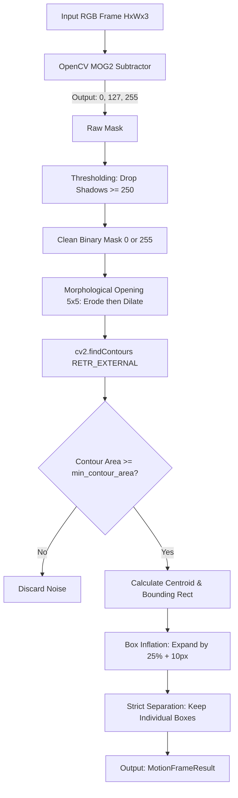

# Stream A: Class-Agnostic Motion Extraction Engine
### *Module 1 of the Dual-Stream Motion–YOLO Discrepancy Architecture*

---

## Table of Contents
1. [Executive Summary & Architectural Purpose](#1-executive-summary--architectural-purpose)
2. [The Core Computer Vision Theory](#2-the-core-computer-vision-theory)
   - [2.1 The Closed-World Dilemma](#21-the-closed-world-dilemma)
   - [2.2 Classical Pixel Differencing vs. Gaussian Mixture Models](#22-classical-pixel-differencing-vs-gaussian-mixture-models)
   - [2.3 MOG2 Mathematical Formulation](#23-mog2-mathematical-formulation)
   - [2.4 Shadow Modeling: Chromaticity vs. Brightness](#24-shadow-modeling-chromaticity-vs-brightness)
3. [The End-to-End Stream A Pipeline](#3-the-end-to-end-stream-a-pipeline)
   - [Phase 1: Multi-Gaussian Background Update](#phase-1-multi-gaussian-background-update)
   - [Phase 2: Strict Shadow Dropping & Foreground Binarization](#phase-2-strict-shadow-dropping--foreground-binarization)
   - [Phase 3: Morphological Noise Suppression](#phase-3-morphological-noise-suppression)
   - [Phase 4: Contour Extraction & Centroid Computation](#phase-4-contour-extraction--centroid-computation)
   - [Phase 5: Box Inflation (Padding) & Separation Enforcement](#phase-5-box-inflation-padding--separation-enforcement)
4. [The Surveillance Tradeoffs & Solutions](#4-the-surveillance-tradeoffs--solutions)
   - [4.1 The Aperture & Homogeneous Interior Problem](#41-the-aperture--homogeneous-interior-problem)
   - [4.2 Why Mask Closing Explodes Trees (and Why Box Padding Fixes It)](#42-why-mask-closing-explodes-trees-and-why-box-padding-fixes-it)
   - [4.3 Preventing Box Collisions / Inadvertent Merging](#43-preventing-box-collisions--inadvertent-merging)
5. [Code Architecture & Module Breakdown](#5-code-architecture--module-breakdown)
   - [5.1 `config.py`: The Parameter Dataclass](#51-configpy-the-parameter-dataclass)
   - [5.2 `motion_extractor.py`: The Core Extraction Engine](#52-motion_extractorpy-the-core-extraction-engine)
   - [5.3 `visualizer.py`: The Multi-Panel Diagnostic HUD](#53-visualizerpy-the-multi-panel-diagnostic-hud)
   - [5.4 `run_stream_a.py`: The Standalone CLI Runner](#54-run_stream_apy-the-standalone-cli-runner)
6. [Complete Configuration & Parameter Tuning Reference](#6-complete-configuration--parameter-tuning-reference)
7. [CLI Usage Guide & Production Recipes](#7-cli-usage-guide--production-recipes)
8. [Data Contracts with Downstream Modules](#8-data-contracts-with-downstream-modules)

---

## 1. Executive Summary & Architectural Purpose

In automated video surveillance, deep learning object detectors (like YOLOv8 or YOLOv11) operate strictly under a **closed-world assumption**: they detect only the semantic classes they were explicitly trained on (e.g., *person*, *car*, *bus*). If an unknown moving entity enters the scene—such as rolling industrial equipment, falling cargo, wild animals, or carried contraband—standard detectors classify it as invisible background.

```
+-----------------------------------------------------------------------------+
|               DUAL-STREAM DISCREPANCY PIPELINE OVERVIEW                     |
|                                                                             |
|   +-----------------------+              +-----------------------+          |
|   | STREAM A (This Module)|              |  STREAM B (YOLOv8/11) |          |
|   | Class-Agnostic Motion |              |  Semantic Detections  |          |
|   | MOG2 Pixel Subtraction|              |  [Person, Car, etc.]  |          |
|   +-----------+-----------+              +-----------+-----------+          |
|               |                                      |                      |
|               | (H, W, 1) Binary Mask                | [K, 4] Known Boxes   |
|               v                                      v                      |
|       +------------------------------------------------------+              |
|       |     MODULE 3: MASK-LEVEL ERASURE & EXTRACTION        |              |
|       |  Digitally erase Stream B boxes from Stream A mask   |              |
|       +--------------------------+---------------------------+              |
|                                  | Surviving Unknown Motion Blobs           |
|                                  v                                          |
|       +------------------------------------------------------+              |
|       |         MODULE 4: TEMPORAL TRAJECTORY GATING         |              |
|       |     ByteTrack Kalman filtering & directional sanity  |              |
|       +--------------------------+---------------------------+              |
|                                  | Confirmed Unknown Moving Objects         |
|                                  v                                          |
|                       ALERT & ACTIVE RETRAINING                             |
+-----------------------------------------------------------------------------+
```

### The Role of Stream A
Stream A is the **Recall Anchor** of the entire surveillance system. It does not know or care *what* an object is; it cares exclusively about **physical displacement**. If an object moves, Stream A guarantees that its pixels are flagged. 

Downstream Module 3 then paints all known YOLO bounding boxes black on Stream A's mask. **Whatever motion survives this digital erasure is mathematically guaranteed to be an unknown moving object.**

---

## 2. The Core Computer Vision Theory

### 2.1 The Closed-World Dilemma
Deep neural networks optimize a categorical distribution $P(y \in C \mid X)$, where $C$ is a finite set of labeled classes. When presented with an out-of-distribution object $X_{\text{unknown}}$, the model outputs low softmax probabilities across all classes and discards the detection after Non-Maximum Suppression (NMS). Stream A bypasses deep learning entirely, operating directly on low-level temporal pixel statistics.

### 2.2 Classical Pixel Differencing vs. Gaussian Mixture Models
- **Frame Differencing ($|I_t - I_{t-1}|$):** Simple and fast, but leaves the interior of uniformly colored moving objects hollow and fails whenever an object temporarily pauses.
- **Static Background Subtraction ($|I_t - B|$):** Fails immediately when clouds pass, shadows shift, or daylight changes.
- **Adaptive Mixture of Gaussians (MOG2):** Models the historical color distribution of each individual pixel as a mixture of $K$ Gaussian distributions. This allows a single pixel to model multi-modal states (such as a parking space that is sometimes asphalt, sometimes shadow, or a tree branch that sways between green leaves and blue sky).

### 2.3 MOG2 Mathematical Formulation
For each pixel coordinate $(x, y)$, the probability of observing the current color vector $\vec{x}_t$ at time $t$ is modeled as:

$$P(\vec{x}_t) = \sum_{i=1}^{K} \omega_{i, t} \cdot \eta(\vec{x}_t, \vec{\mu}_{i, t}, \Sigma_{i, t})$$

Where:
- $K$: Number of Gaussian components (typically 3 to 5, dynamically adjusted by MOG2).
- $\omega_{i, t}$: Weight of the $i$-th Gaussian component at time $t$, representing what proportion of time that color state has been present ($\sum \omega_i = 1$).
- $\vec{\mu}_{i, t}$: Mean color vector in RGB/YUV space.
- $\Sigma_{i, t} = \sigma_{i, t}^2 \mathbf{I}$: Covariance matrix (assumed isotropic for real-time performance).

#### Background Classification Criterion
The Gaussians are ordered by the ratio $\frac{\omega_i}{\sigma_i}$ (high weight and low variance represent permanent, stable background). The first $B$ Gaussians that satisfy the background threshold $T$ are considered the background model:

$$B = \arg\min_b \left( \sum_{i=1}^{b} \omega_i > T \right)$$

If an incoming pixel $\vec{x}_t$ falls within $2.5$ standard deviations ($\text{varThreshold} = 16.0 \approx 4^2 \sigma$) of any of the $B$ background Gaussians, it is classified as **background**. If it does not match any background component, it is flagged as **foreground motion**.

### 2.4 Shadow Modeling: Chromaticity vs. Brightness
A moving object casts a shadow on the road. The road surface under the shadow does not change its material color (chromaticity); it only suffers a drop in luminance. 

OpenCV's MOG2 explicitly decomposes the pixel difference into **brightness distortion** ($\alpha$) and **chromaticity distortion** ($CD$):

$$\alpha = \frac{\vec{x}_t \cdot \vec{\mu}_B}{\|\vec{\mu}_B\|^2}, \quad CD = \|\vec{x}_t - \alpha \vec{\mu}_B\|$$

- If chromaticity $CD$ is preserved while brightness drops within a shadow range ($\tau \le \alpha < 1$), MOG2 labels the pixel as **Shadow (Pixel Value 127)**.
- If chromaticity shifts significantly, MOG2 labels the pixel as **Foreground Motion (Pixel Value 255)**.
- Stable pixels remain **Background (Pixel Value 0)**.

---

## 3. The End-to-End Stream A Pipeline

The operational pipeline for every incoming frame in `stream_a` follows 5 distinct mathematical stages:



### Phase 1: Multi-Gaussian Background Update
The raw camera frame is passed to `cv2.BackgroundSubtractorMOG2.apply()`. The background subtractor updates the Gaussian weights and variances according to the learning rate $\alpha = \frac{1}{\text{history}}$.

### Phase 2: Strict Shadow Dropping & Foreground Binarization
The raw MOG2 mask contains three pixel values:
* `0`: Background
* `127`: Shadow
* `255`: Foreground Motion

Stream A performs binary thresholding at `shadow_threshold - 1` ($250 - 1 = 249$):
```python
_, clean_mask = cv2.threshold(raw_mask, 249, 255, cv2.THRESH_BINARY)
```
This forces all shadow pixels ($127$) to zero, preventing cast ground shadows from expanding detection boxes.

### Phase 3: Morphological Noise Suppression
Real camera sensors produce salt-and-pepper noise, and outdoor CCTV cameras capture slight foliage flutter. Stream A applies a **Morphological Opening** using a $5 \times 5$ rectangular structuring element:

$$\text{CleanMask} = ( \text{CleanMask} \ominus K_{5\times5} ) \oplus K_{5\times5}$$

1. **Erosion ($\ominus$):** Wipes out any isolated noise specks smaller than $5 \times 5$ pixels.
2. **Dilation ($\oplus$):** Restores the remaining valid foreground components to their original size.

### Phase 4: Contour Extraction & Centroid Computation
Surviving connected components are extracted using `cv2.findContours(..., cv2.RETR_EXTERNAL, cv2.CHAIN_APPROX_SIMPLE)`. For each contour:
1. Contour area is computed via Green's theorem: $A = \oint x \, dy$.
2. Any contour with $A < \text{min\_contour\_area}$ ($200$ px) is rejected.
3. The spatial centroid is computed using image spatial moments $m_{00}, m_{10}, m_{01}$:

$$c_x = \frac{m_{10}}{m_{00}} = \frac{\sum x \cdot I(x, y)}{\sum I(x, y)}, \quad c_y = \frac{m_{01}}{m_{00}} = \frac{\sum y \cdot I(x, y)}{\sum I(x, y)}$$

### Phase 5: Box Inflation (Padding) & Separation Enforcement
Because background subtraction only captures the high-contrast motion boundaries, raw bounding boxes are often tighter than the physical object. Stream A inflates the bounding box coordinates outward by **$25\%$ of the object's width/height plus a fixed $10$ px border**:

$$\text{pad}_x = \max(10, \text{round}(0.25 \cdot w)), \quad \text{pad}_y = \max(10, \text{round}(0.25 \cdot h))$$
$$x_1 = \max(0, x - \text{pad}_x), \quad y_1 = \max(0, y - \text{pad}_y)$$
$$x_2 = \min(W, x + w + \text{pad}_x), \quad y_2 = \min(H, y + h + \text{pad}_y)$$

Crucially, **`merge_overlapping_boxes = False`** ensures that when two cars or two pedestrians travel in close proximity, their boxes remain independent and never collapse into one large bounding box.

---

## 4. The Surveillance Tradeoffs & Solutions

### 4.1 The Aperture & Homogeneous Interior Problem
When a car drives across the camera frame, its roof, hood, and door panels are painted in a uniform, solid color. From frame $t$ to frame $t+1$, the interior pixels replace each other with identical RGB values. Consequently:
* **MOG2 triggers motion only at the leading edge (front bumper) and trailing edge (rear window/trunk).**
* The center of the vehicle remains undetected background.

### 4.2 Why Mask Closing Explodes Trees (and Why Box Padding Fixes It)
* **The Failed Approach (v2 / v3):** Applying heavy morphological closing ($15 \times 15$ kernels) or temporal stacking inside the binary mask connects the car's hood and trunk into a solid shape. However, in outdoor surveillance, trees and bushes flutter in the wind. A heavy closing filter fuses hundreds of tiny leaf flutter specks into **giant false-alarm monster boxes** covering entire trees.
* **The Stream A Solution (Box Inflation):** We keep the underlying binary mask **strictly clean and noise-free** (using strict shadow dropping and $5 \times 5$ opening). We then enlarge the **bounding box geometry** around detected motion. This wraps the full vehicle cleanly while leaving trees completely unaffected.

### 4.3 Preventing Box Collisions / Inadvertent Merging
In heavy traffic or crowded walkways, two separate moving entities (e.g. an SUV and a sedan traveling in adjacent lanes) often have bounding boxes that come into contact. If an algorithm greedily merges touching boxes, the two vehicles merge into a single bounding box. 
By setting `merge_overlapping_boxes = False`, Stream A guarantees that:
- Every distinct motion contour maintains its own trackable identity.
- Multi-object scenes preserve individual centroids and bounding coordinates for Module 4 tracking.

---

## 5. Code Architecture & Module Breakdown

All Stream A files are strictly self-contained within `c:\fyp_new\stream_a\`:

```
c:\fyp_new\stream_a\
├── __init__.py           # Clean package exports (API contract)
├── config.py             # Data structures: MotionConfig, MotionBoundingBox, MotionFrameResult
├── motion_extractor.py   # MOG2MotionExtractor: Background subtraction, morphology, boxes
├── visualizer.py         # StreamAVisualizer: Multi-panel canvas renderer, HUD, MP4 encoder
├── run_stream_a.py       # Production CLI runner with argument parsing & interactive preview
└── README.md             # This detailed technical documentation
```

### 5.1 `config.py`: The Parameter Dataclass
Encapsulates all runtime hyperparameters into strongly typed dataclasses:

```python
@dataclass
class MotionConfig:
    history: int = 500                    # Frame memory length for MOG2
    var_threshold: float = 16.0           # Mahalanobis variance threshold
    detect_shadows: bool = True           # Enable shadow segmentation
    shadow_threshold: int = 250           # Drop all pixels < 250 (drops 127 shadows)
    morph_kernel_size: Tuple[int, int] = (5, 5) # Opening kernel dimensions
    morph_open_iterations: int = 1        # Opening iterations
    morph_close_iterations: int = 1       # Closing iterations
    min_contour_area: float = 200.0       # Minimum pixel area for valid moving part
    box_pad_ratio: float = 0.25           # Proportional box inflation (25%)
    box_pad_px: int = 10                  # Fixed pixel box inflation
    merge_overlapping_boxes: bool = False # Keep distinct boxes separate
    learning_rate: float = -1.0           # Auto background adaptation rate
```

### 5.2 `motion_extractor.py`: The Core Extraction Engine
Implements `MOG2MotionExtractor`:
- `__init__(config)`: Allocates OpenCV subtractor and morphological structuring elements once to avoid per-frame heap allocation.
- `reset()`: Resets background history upon video cut or camera scene switch.
- `process(frame)`: Processes single frames `(H, W, 3) -> MotionFrameResult`. Fully thread-safe across sequential frames.

### 5.3 `visualizer.py`: The Multi-Panel Diagnostic HUD
Builds a synchronized composite frame ($1440 \times 540$) optimized for operator inspection and verification:
- **Left View ($960 \times 540$):** Camera feed with bounding boxes, area tags, centroid markers, and a real-time HUD telemetry card showing FPS, frame count, detected parts, and active motion percentage.
- **Top Right View ($480 \times 270$):** Raw MOG2 Mask with custom colorization (White = Foreground, Orange = Cast Shadows, Black = Background).
- **Bottom Right View ($480 \times 270$):** Clean Binary Mask (Black = Background, Neon Green = Active Clean Foreground).

### 5.4 `run_stream_a.py`: The Standalone CLI Runner
Provides a production command-line interface featuring:
- Automatic video resolution and framerate detection.
- Headless high-speed video rendering with automated MP4 encoding (`mp4v`/`XVID`).
- Interactive desktop preview window (`--preview`) with `Space` (Pause/Resume) and `Q` (Quit) keybindings.
- Periodic progress telemetry reporting to stdout.
- Automated snapshot exports to `outputs/snapshots/`.

---

## 6. Complete Configuration & Parameter Tuning Reference

| Parameter | Default | Recommended Range | What It Controls | When to Adjust |
| :--- | :--- | :--- | :--- | :--- |
| `history` | `500` | `200` – `1000` | Number of historical frames influencing the background. | Increase for slow-moving traffic; decrease for rapid illumination changes. |
| `var_threshold` | `16.0` | `12.0` – `35.0` | Pixel difference variance threshold. | Increase if wind or camera shake causes false foreground; decrease for subtle motion. |
| `min_contour_area` | `200.0` | `150.0` – `800.0` | Minimum bounding area in pixels. | Set higher ($500+$) to completely eliminate rustling leaves and small animals. |
| `box_pad_ratio` | `0.25` | `0.10` – `0.40` | Proportional bounding box expansion. | Increase if boxes clip the front bumper or shoes; decrease if boxes feel too loose. |
| `box_pad_px` | `10` | `5` – `25` | Minimum pixel padding added to all sides. | Ensures tiny distant objects receive sufficient surrounding context. |
| `merge_overlapping_boxes` | `False` | `True` / `False` | Merging of touching boxes. | Keep `False` to track closely traveling vehicles or people separately. |
| `shadow_threshold` | `250` | `200` – `255` | Foreground intensity threshold. | Values $>127$ guarantee shadow elimination. |

---

## 7. CLI Usage Guide & Production Recipes

### 1. Default Baseline Execution (Fast Headless Export)
Processes the default VIRAT surveillance clip and saves diagnostic video to `outputs/stream_a_demo.mp4`:
```powershell
python stream_a/run_stream_a.py --video "CCTV 01/VIRAT_S_000205_05_001092_001124.mp4"
```

### 2. Live Interactive Desktop Preview
Opens a GUI preview window with live keyboard control:
```powershell
python stream_a/run_stream_a.py --video "CCTV 01/VIRAT_S_000205_05_001092_001124.mp4" --preview
```
- **`Spacebar`**: Pause / Resume video.
- **`Q`**: Stop processing and finalize video.

### 3. Tightening the Boxes for Denser Crowds
If multiple pedestrians are walking close to each other, reduce padding:
```powershell
python stream_a/run_stream_a.py --video "CCTV 01/VIRAT_S_010001_00_000019_000065.mp4" --box_pad_ratio 0.15 --box_pad_px 5 --preview
```

### 4. Enlarging Boxes for High-Speed Highway / Vehicle Traffic
For large vehicles where bumper-to-bumper coverage is desired:
```powershell
python stream_a/run_stream_a.py --video "CCTV 01/VIRAT_S_000205_05_001092_001124.mp4" --box_pad_ratio 0.35 --box_pad_px 15 --preview
```

### 5. High-Wind Environment (Filtering Out Tree Sway)
Raise `var_threshold` and `min_area` to ignore violent tree movements:
```powershell
python stream_a/run_stream_a.py --var_threshold 25.0 --min_area 500.0 --preview
```

---

## 8. Data Contracts with Downstream Modules

When integrating with **Module 3 (Mask-Level Discrepancy Engine)**, `MOG2MotionExtractor.process()` returns `MotionFrameResult`:

```python
result = extractor.process(frame)

# 1. Clean Binary Mask (Passed to Module 3 for YOLO Box Erasure)
# Shape: (H, W), dtype: uint8, Values: strictly 0 or 255
binary_mask = result.clean_mask

# 2. Moving Part Bounding Boxes (Passed to Module 4 / Diagnostics)
# List of MotionBoundingBox objects
for box in result.boxes:
    x1, y1, x2, y2 = box.to_xyxy()     # Coordinates in image space
    area_px = box.area                  # Enclosed pixel area
    cx, cy = box.centroid               # Center of motion mass
```

### Downstream Interaction Logic (Module 3 Preview):
```python
# In Module 3:
# For each known YOLO detection [x1, y1, x2, y2] from Stream B:
#   1. Add 10% dilation padding to YOLO box
#   2. Paint that rectangular region to 0 on binary_mask
# Any remaining non-zero pixel clusters are Unknown Moving Objects!
```
